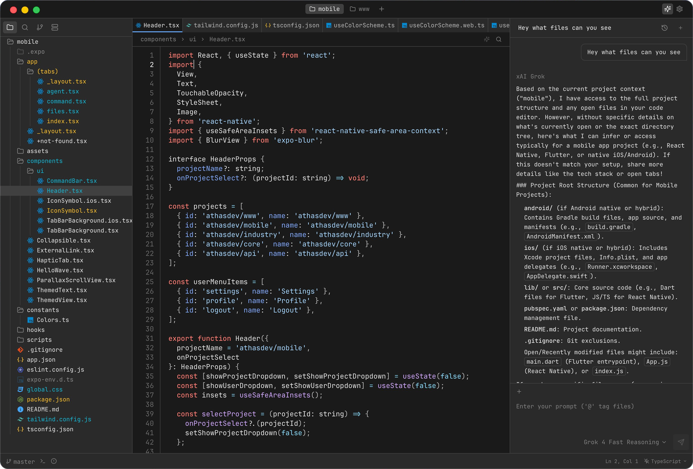

<div align="center">
  
  <h1>Athas</h1>
  <p>A lightweight, cross-platform code editor, built with <a href="https://tauri.app/" title="Tauri">Tauri</a> (Rust and React) with Git support, AI agents, vim keybindings.</p>
  
</div>

## Features

- AI agents
- Git integration
- Syntax highlighting
- LSP support
- Vim keybindings
- Integrated terminal
- Database viewers
- Collaboration
- Enterprise policy controls (managed mode + extension allowlist)

## Installation

### Quick install

macOS and Linux:

```bash
curl -fsSL https://athas.dev/install.sh | sh
```

Windows (PowerShell):

```powershell
powershell -ExecutionPolicy ByPass -c "irm https://athas.dev/install.ps1 | iex"
```

The install scripts detect your operating system and architecture, download the latest stable
release, and verify its SHA256 checksum when one is available. You can review the
[macOS and Linux script](https://athas.dev/install.sh) or
[Windows script](https://athas.dev/install.ps1) before running it.

### Package managers

Homebrew on macOS:

```bash
brew install --cask athas
```

APT on Debian and Ubuntu:

```bash
sudo install -d -m 0755 /etc/apt/keyrings
curl -fsSL https://athas.dev/apt/athas.gpg | sudo tee /etc/apt/keyrings/athas.gpg > /dev/null
echo "deb [arch=amd64,arm64 signed-by=/etc/apt/keyrings/athas.gpg] https://athas.dev/apt stable main" \
  | sudo tee /etc/apt/sources.list.d/athas.list > /dev/null
sudo apt update && sudo apt install athas
```

DNF on Fedora and RHEL:

```bash
sudo curl -fsSL https://athas.dev/rpm/athas.repo -o /etc/yum.repos.d/athas.repo
sudo dnf install athas
```

Installs from the APT and DNF repositories update with `apt upgrade` and `dnf upgrade`.

### Manual download

Prebuilt packages for macOS, Windows, and Linux are available on the
[GitHub Releases page](https://github.com/athasdev/athas/releases). Linux releases include native
`.deb` and `.rpm` packages, an AppImage, and a portable `.tar.gz` bundle that uses the system
WebKitGTK 4.1.

See the [installation guide](https://athas.dev/docs/installation) for detailed platform steps,
install locations, and uninstall instructions.

## Development

To build Athas from source, install [Node.js 24](https://nodejs.org),
[Bun 1.3.14](https://bun.sh), and [Rust](https://rustup.rs), then run:

```bash
git clone https://github.com/athasdev/athas.git
cd athas
bun setup
bun dev
```

`bun setup` installs the project dependencies and checks the native requirements for your
platform. See the [contributing guide](CONTRIBUTING.md) for validation commands and contribution
guidelines.

## Documentation

See the [documentation](https://athas.dev/docs).

## Contributing

Contributions are welcome! See the [contributing guide](CONTRIBUTING.md). Pull requests need agreement to the [Contributor License and Feedback Agreement](CONTRIBUTOR_LICENSE_AND_FEEDBACK_AGREEMENT.md).

## Support

- [Issues](https://github.com/athasdev/athas/issues)
- [Discussions](https://github.com/athasdev/athas/discussions)
- [Discord](https://discord.gg/DD8F38wFMv)

## License

Copyright (C) 2022-2026 Athas

Athas is free software: you can redistribute it and/or modify it under the terms of the [GNU Affero General Public License](LICENSE) as published by the Free Software Foundation, either version 3 of the License, or (at your option) any later version.

Athas is distributed in the hope that it will be useful, but WITHOUT ANY WARRANTY; without even the implied warranty of MERCHANTABILITY or FITNESS FOR A PARTICULAR PURPOSE. See the GNU Affero General Public License for more details.

Athas may also be distributed under other terms, such as through the Mac App Store or in commercial editions. The [Contributor License and Feedback Agreement](CONTRIBUTOR_LICENSE_AND_FEEDBACK_AGREEMENT.md) gives the project the rights to do so for code contributed on or after 2026-10-15.
